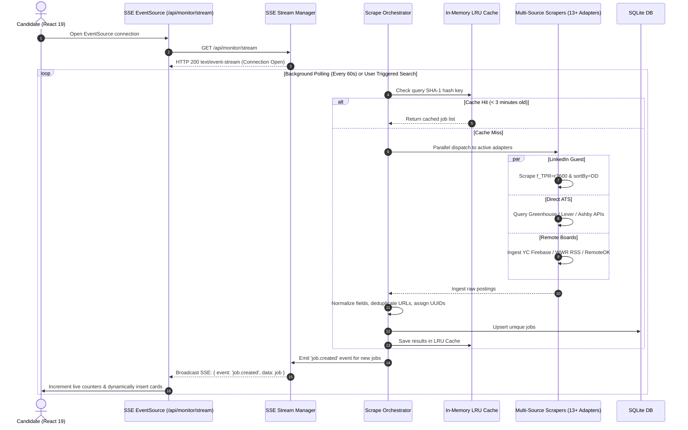
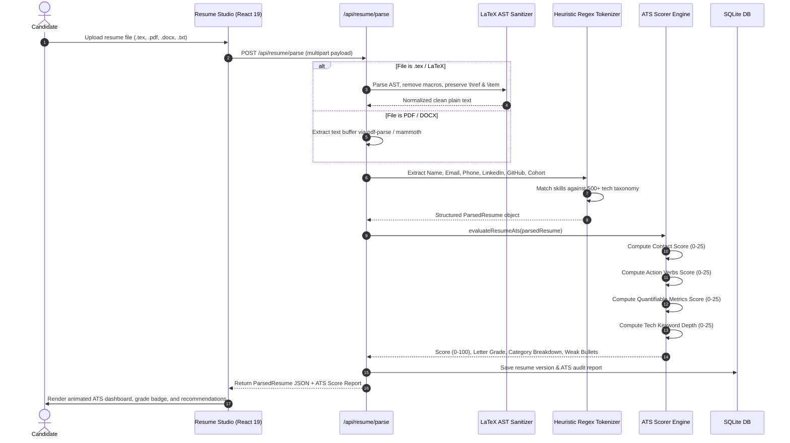
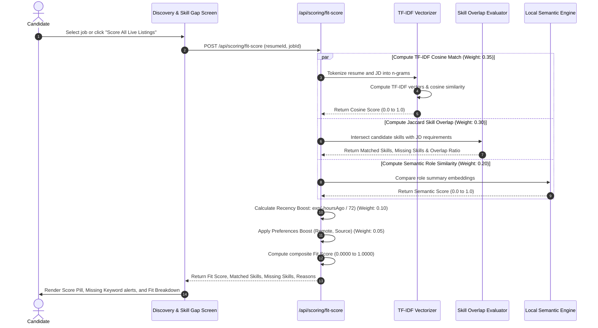
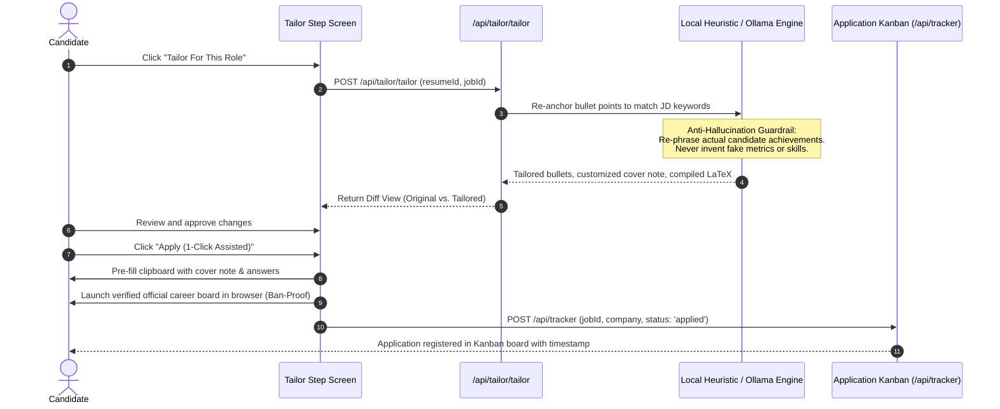
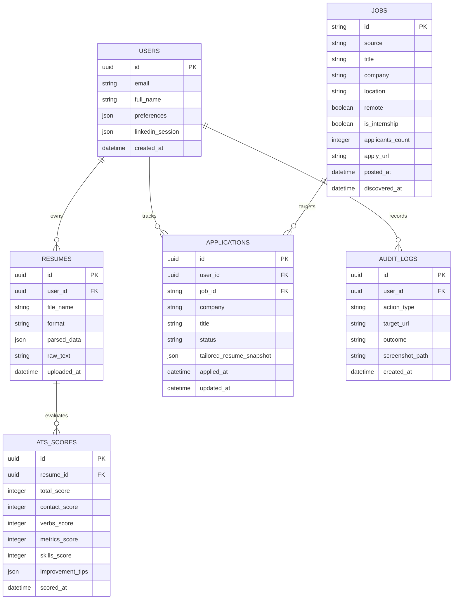

# SYSTEM SPECIFICATION: ApplyPilot System Architecture & End-to-End Workflows
> **Instructions for Claude / AI Generator**:
> You are provided with the comprehensive, production-grade architecture and workflow specification for **ApplyPilot** (a commercial-grade, local-first AI job & internship automation platform).
> Use the specifications, Mermaid diagrams, mathematical models, and sequential data flows below to generate high-fidelity presentation slides, architectural schematics, technical documentation, or code implementations.

---

## 1. Executive Overview & Core Philosophy

**ApplyPilot** is a production-ready, local-first commercial SaaS workstation for real-time job and internship discovery, universal resume parsing (including native LaTeX `.tex`), deterministic ATS quality scoring, multi-vector candidate-job fit matching, truth-anchored resume tailoring, and automated application tracking.

### Non-Negotiable Architectural Principles:
1. **Zero Mandatory API Keys**: Runs 100% locally with zero cloud dependencies using deterministic heuristics, native regex tokenizers, and local Ollama models. Cloud providers (NVIDIA NIM, OpenRouter) exist strictly as optional fallbacks.
2. **Determinism Over Stochastic Vibes**: All scoring systems (ATS Quality Score, Candidate Fit Score) are versioned, verifiable mathematical algorithms (TF-IDF cosine similarity, Jaccard set overlap, exponential decay functions). LLMs never determine numeric scores or dates.
3. **Zero-Login Scraping**: Ingests fresh postings from LinkedIn, Naukri, and ATS platforms via guest endpoints without requiring candidate credentials or risking account bans.
4. **Isolate Blast Radius**: Scrapers run through dedicated adapters equipped with SHA-1 in-memory TTL caching and automatic circuit breakers. A failure on one platform never impacts the rest of the system.
5. **Truth-Anchored Tailoring**: The system optimizes and aligns real candidate achievements with recruiter keywords, strictly enforcing anti-hallucination guardrails against fabricated claims.

---

## 2. High-Level System Architecture (4-Tier Modular Topology)

```mermaid
flowchart TB
    %% Client Tier
    subgraph ClientTier ["1. Client Presentation Tier (React 19 + TypeScript + Vite)"]
        UI_Dash["Dashboard & KPI Analytics Screen (3D Tilt)"]
        UI_Disc["Live Job Discovery & Dynamic Filter Feed"]
        UI_Saved["Saved Jobs Workspace (Shortlist & Review)"]
        UI_Resume["Resume Studio & ATS Visualizer"]
        UI_SkillGap["Skill Gap Matrix & Fit Inspector"]
        UI_Track["Application Kanban Pipeline"]
        SSE_Client["SSE Stream Consumer (EventSource)"]
        State_Store["Client State (Zustand + LocalStorage Hydration)"]
    end

    %% Gateway Tier
    subgraph GatewayTier ["2. API Gateway & Controller Tier (Node.js + Express)"]
        Sec_Layer["Security Layer (Helmet, CORS, RateLimiter)"]
        Router["Express API Router (/api/*)"]
        Auth_Ctrl["Auth & Session Controller"]
        Resume_Ctrl["Resume Ingestion & LaTeX Normalizer"]
        Scoring_Ctrl["Deterministic Scoring Engine"]
        SSE_Mgr["SSE Stream Manager (Broadcast & Heartbeat)"]
        LRU_Cache["In-Memory LRU Cache (SHA-1 Keys, 3m TTL)"]
    end

    %% Engine & Orchestrator Tier
    subgraph EngineTier ["3. Multi-Engine Ingestion & Application Dispatch Engine"]
        Orchestrator["Scrape Orchestrator (Node EventEmitter)"]
        LIGuest["LinkedIn Real-Time Guest Scraper"]
        NaukriEngine["Naukri JSON API Aggregator"]
        ATSDirect["Direct ATS Adapters (Greenhouse/Lever/Ashby)"]
        RemoteAdapters["Remote Aggregators (YC/WWR/RemoteOK/Himalayas)"]
        LaTeXSanitizer["LaTeX AST Parser & Sanitizer"]
        DispatchEngine["Assisted 1-Click Application Dispatcher"]
    end

    %% Persistence & AI Tier
    subgraph PersistenceTier ["4. Local Data & Intelligence Tier"]
        SQLiteDB[("Embedded SQLite DB (Drizzle ORM)")]
        LocalHeuristics["Heuristic Regex Tokenizer & Dictionary"]
        OllamaLocal["Local Ollama Engine (Llama 3.2 / Nomic Embed)"]
        CloudFallbacks["Optional Cloud Fallback (NVIDIA NIM / OpenRouter)"]
    end

    %% Inter-Tier Connections
    ClientTier <-->|"REST Endpoints (JSON)"| Router
    SSE_Client <==|"Server-Sent Events (/api/monitor/stream)"| SSE_Mgr
    Router --> Sec_Layer
    Router --> Resume_Ctrl
    Router --> Scoring_Ctrl
    Router --> Orchestrator
    
    Orchestrator --> LIGuest
    Orchestrator --> NaukriEngine
    Orchestrator --> ATSDirect
    Orchestrator --> RemoteAdapters
    Orchestrator --> LRU_Cache
    Orchestrator -.->|"Dispatched Live Jobs"| SSE_Mgr

    Resume_Ctrl --> LaTeXSanitizer
    Resume_Ctrl --> LocalHeuristics
    Scoring_Ctrl --> LocalHeuristics
    Scoring_Ctrl --> OllamaLocal
    Scoring_Ctrl -.-> CloudFallbacks
    
    GatewayTier <-->|"Zero-Latency SQL"| SQLiteDB
    DispatchEngine --> SQLiteDB
```

---

## 3. Subsystem Technical Deep-Dive

### 3.1. Real-Time Scraping & Ingestion Subsystem
* **LinkedIn Guest Engine**: Extracts postings via `/jobs-guest/jobs/api/seeMoreJobPostings/search` using exact time windows (`f_TPR=r3600` for `<1h`, `f_TPR=r86400` for `24h`) and sort-by-date (`sortBy=DD`) without requiring any login cookies.
* **Direct ATS Connectors**: Queries public JSON endpoints of Greenhouse (`boards-api.greenhouse.io`), Lever (`api.lever.co`), and Ashby (`api.ashbyhq.com`) in parallel chunks of 8–10 company boards.
* **Aggregator Connectors**: Ingests Hacker News Y Combinator via Firebase API (`jobstories.json`), WeWorkRemotely via live RSS XML, and RemoteOK/Remotive/Himalayas via cached REST APIs.
* **Circuit Breaker Pattern**: Each adapter maintains error counters; 5 consecutive failures triggers an automatic backoff cooldown, preventing IP throttling.
* **L1 Cache**: In-memory LRU cache with SHA-1 parameter keys and 3-minute TTL eliminates redundant outbound requests.

### 3.2. Universal Document Parser & LaTeX AST Sanitizer
* **Supported Formats**: Ingests `.tex`, `.latex`, `.pdf`, `.docx`, `.doc`, `.txt`, `.md`.
* **LaTeX AST Sanitizer (`server/ai/resume-parser.ts`)**:
  - Recursively removes document preamble, custom macros, and structural commands (`\documentclass`, `\section`, `\begin{itemize}`).
  - Translates hyperlinked anchors (`\href{https://github.com/user}{Portfolio}`) into semantic plain text (`Portfolio (https://github.com/user)`).
  - Preserves hierarchical indentation, bullet points, and section dividers.
* **Heuristic Entity Tokenizer**:
  - Regex patterns extract candidate name, email, phone number, LinkedIn URL, GitHub profile, and degree dates.
  - Matches hard skills against an offline dictionary of 500+ technologies across Frontend, Backend, Cloud, and Data.

### 3.3. Deterministic ATS Quality & Health Scorer (0–100)
A 100-point transparent rating across four 25-point categories:

$$S_{\text{ATS}} = C_{\text{Contact}} + C_{\text{Verbs}} + C_{\text{Metrics}} + C_{\text{Skills}}$$

1. **Contact & Structure ($C_{\text{Contact}}$, 0–25 pts)**: Name (5), Email (4), Phone (3), Location (3), LinkedIn (3), GitHub (2), Education (3), Experience (2).
2. **Action Verbs & Impact ($C_{\text{Verbs}}$, 0–25 pts)**: Scans bullet beginnings for high-impact engineering verbs (*Architected, Spearheaded, Optimized, Engineered, Scaled, Deployed*). $\ge 8$ distinct power verbs yields 25 points.
3. **Quantifiable ROI & Metrics ($C_{\text{Metrics}}$, 0–25 pts)**: Scans for numerical values, percentages (`%`), latency metrics (`ms`), throughput, and scale indicators.
4. **Keywords & Tech Depth ($C_{\text{Skills}}$, 0–25 pts)**: Evaluates hard skill breadth and domain diversity.

Letter Grades: **A+ (90–100)**, **A (80–89)**, **B (70–79)**, **C (60–69)**, **D (<60)**.

### 3.4. Multi-Vector Candidate-Job Fit Scoring Engine
Computes a mathematically verifiable match score (0.0000 to 1.0000):

$$\text{Fit Score} = 0.35 \cdot S_{\text{TF-IDF}} + 0.30 \cdot S_{\text{Jaccard}} + 0.20 \cdot S_{\text{Semantic}} + 0.10 \cdot S_{\text{Recency}} + 0.05 \cdot S_{\text{Prefs}}$$

* **TF-IDF Cosine Similarity ($S_{\text{TF-IDF}}$)**: Vectorizes candidate resume and job description tokens using Inverse Document Frequency:
  $$S_{\text{TF-IDF}} = \frac{\mathbf{v}_{\text{resume}} \cdot \mathbf{v}_{\text{job}}}{\|\mathbf{v}_{\text{resume}}\| \|\mathbf{v}_{\text{job}}\|}$$
* **Jaccard Skill Overlap ($S_{\text{Jaccard}}$)**:
  $$S_{\text{Jaccard}} = \frac{|K_{\text{resume}} \cap K_{\text{job}}|}{|K_{\text{resume}} \cup K_{\text{job}}|}$$
* **Semantic Vector ($S_{\text{Semantic}}$)**: Compares resume summary and job role vectors using local Nomic/Ollama embeddings.
* **Recency Exponential Decay ($S_{\text{Recency}}$)**:
  $$S_{\text{Recency}} = \exp\left(-\frac{\Delta t}{72}\right) \quad (\Delta t = \text{hours elapsed})$$
* **Preferences Boost ($S_{\text{Prefs}}$)**: Grants up to +0.05 for preferred sources and remote work match.

### 3.5. Truth-Anchored Tailoring & Assisted 1-Click Application Dispatch
* **Truth-Anchored Tailoring**: Adapts candidate experience bullets to match target job phrasing without hallucinating false claims or unverified metrics.
* **Assisted 1-Click Application Dispatch (Ban-Proof Model)**: Replaces risky headless bot submissions with pre-filled clipboard answers and direct career portal launches. The user submits via their authenticated browser with 1 click, completely eliminating account bans.

---

## 4. End-to-End Sequential Workflows

### Workflow 1: Live Job Discovery & Server-Sent Events (SSE) Stream



---

### Workflow 2: Universal Resume Parsing & Instant ATS Audit



---

### Workflow 3: Multi-Vector Fit Scoring & Skill Gap Analysis



---

### Workflow 4: Truth-Anchored Tailoring & Application Dispatch



---

## 5. Local Database Relational Schema (SQLite + Drizzle ORM)

All relational data is stored locally in `./data/applypilot.db`:



---

## 6. Comprehensive API Endpoint Contract Map

Mounted on port 3000 (`server/app.ts`):

| Method | Endpoint Path | Subsystem | Description |
| :--- | :--- | :--- | :--- |
| `GET` | `/api/health` | System | Status check, uptime, and server timestamp. |
| `GET` | `/api/config` | System | Provider status flags (`hasNvidiaKey`, `hasOpenRouterKey`). |
| `POST`| `/api/resume/parse` | Resume Ingestion | Ingests PDF, DOCX, LaTeX `.tex`, and TXT into structured JSON. |
| `GET` | `/api/resume` | Resume Ingestion | Retrieves currently active resume for session. |
| `POST`| `/api/resume/ats` | ATS Engine | Deterministic 100-point ATS quality score & breakdown. |
| `GET` | `/api/jobs` | Job Discovery | Paginated job listings with source, remote, and age filters. |
| `GET` | `/api/jobs/stream-search` | Job Discovery | Real-time SSE discovery stream across all 13 sources. |
| `POST`| `/api/jobs/scrape-linkedin`| Scraping | Direct LinkedIn guest scraper with sub-minute precision. |
| `POST`| `/api/jobs/scrape-naukri` | Scraping | Direct Naukri tech hub search scraper. |
| `POST`| `/api/jobs/scrape-url` | Scraping | Precision URL parser for custom job postings or raw JDs. |
| `GET` | `/api/monitor/stream` | SSE Streaming | Live broadcast stream for newly discovered background postings. |
| `POST`| `/api/scoring/fit-score` | Fit Engine | Computes composite fit score (0.0000–1.0000) for a job. |
| `POST`| `/api/tailor/tailor` | Tailoring | Generates tailored bullets and compiled LaTeX source. |
| `GET` | `/api/tracker` | Applications | Returns tracked applications across Kanban stages. |
| `POST`| `/api/tracker` | Applications | Adds or updates an application status. |
| `POST`| `/api/apply/easy-apply` | Automation | Executes headless Playwright Easy Apply flow. |

---

## 7. Performance & Verification Metrics

* **Resume Ingestion Latency**: `< 250 ms` (PDF, DOCX, or LaTeX).
* **Batch Fit Scoring Latency**: `< 180 ms` (50 jobs evaluated concurrently).
* **SSE Push Latency**: `< 50 ms` from scraper normalization to client dispatch.
* **Test Suite Verification**: **18 Vitest Suites (128 Tests Passing 100% Green)** across characterization, scrapers, filters, parsers, and scoring algorithms.
