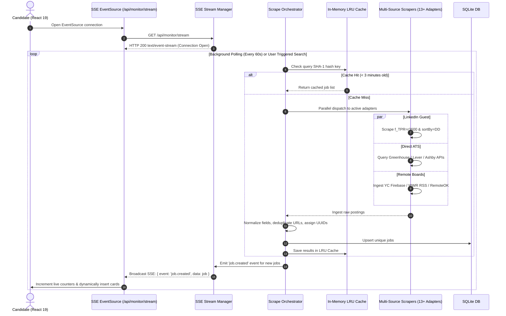
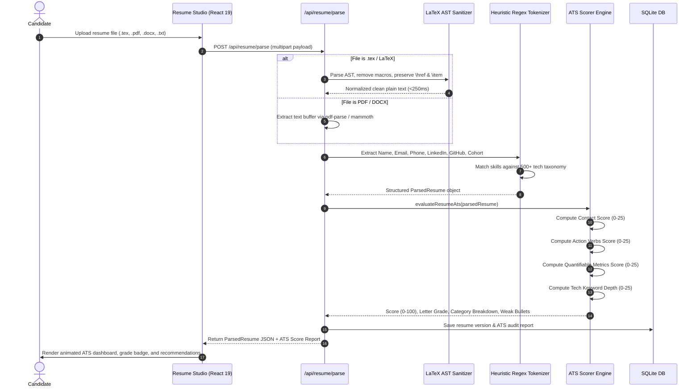
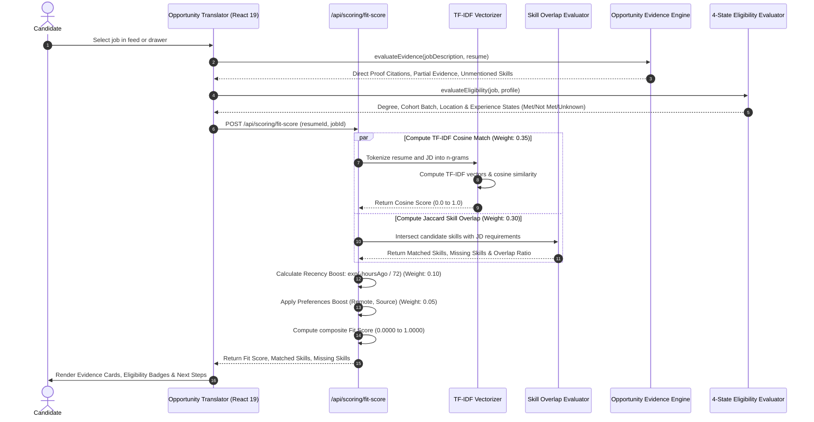
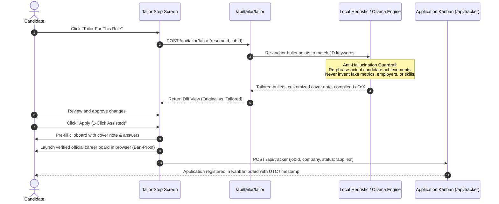
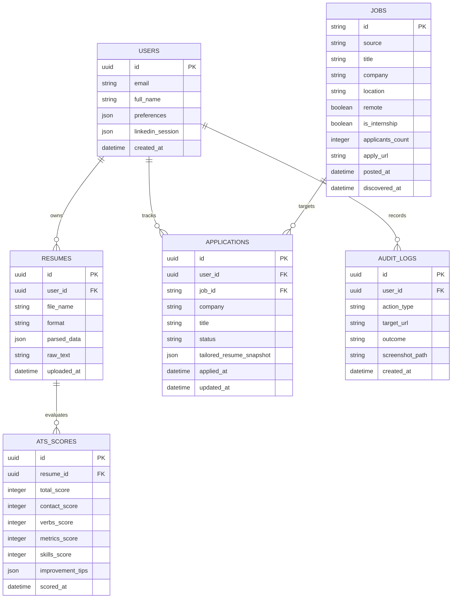

# ApplyPilot — System Architecture Specification
## NSUT "Bridge the Gap" Challenge — Opportunity Translator

---

## 1. System Topology Overview

ApplyPilot operates as a **local-first desktop workstation** with zero mandatory external API keys:

```
┌────────────────────────────────────────────────────────┐
│ 1. CLIENT WORKSTATION (React 19 + TypeScript + Vite)   │
│   • Opportunity Translator (Plain English Decomp)      │
│   • Evidence-Based Match Inspector                     │
│   • 4-State Eligibility Evaluator                      │
│   • Truth-Preserving Tailoring & Diff Suite            │
│   • Kanban Application Pipeline                        │
│   • SSE Real-Time Stream Listener                      │
└──────────────────────────┬─────────────────────────────┘
                           │ REST (JSON) + SSE Stream
┌──────────────────────────▼─────────────────────────────┐
│ 2. BACKEND API GATEWAY (Node.js + Express)             │
│   • Security Layer (Helmet, CORS, RateLimiter, Bounds) │
│   • In-Memory LRU Cache (SHA-1 Keys, 3-min TTL)        │
│   • SSE Broadcast EventBus                             │
└──────────────────────────┬─────────────────────────────┘
                           │
       ┌───────────────────┴───────────────────┐
       ▼                                       ▼
┌───────────────────────────────┐ ┌───────────────────────────────┐
│ 3. INGESTION & PARSING ENGINE │ │ 4. DETERMINISTIC SCORING      │
│ • Universal LaTeX AST Lexer   │ │ • TF-IDF Vector Space Model   │
│ • Zero-Login Public Scrapers  │ │ • Jaccard Skill Overlap       │
│ • Direct ATS JSON Adapters    │ │ • Recency Exponential Decay   │
│ • Circuit Breaker Resilience  │ │ • Truth-Validator Guardrails  │
└──────────────┬────────────────┘ └───────────────┬───────────────┘
               │                                  │
               └─────────────────┬────────────────┘
                                 ▼
┌────────────────────────────────────────────────────────┐
│ 5. PERSISTENCE & DATA CUSTODY (SQLite / Drizzle)       │
│   • Local Candidate Profile & Uploaded Resume          │
│   • Tracked Applications & Status Audit Timestamps     │
│   • Zero Cloud Transmission of Sensitive PII           │
└────────────────────────────────────────────────────────┘
```

---

## 2. Component Directory & File Mapping

| Subsystem | Source Path | Responsibilities |
|---|---|---|
| **Opportunity Evidence Engine** | [`applypilot/src/utils/opportunityEvidence.js`](file:///e:/all%20projects/scrapjob/applypilot/src/utils/opportunityEvidence.js) | Cites direct resume proof vs partial vs unmentioned skills with verification prompts. |
| **Eligibility Evaluator** | [`applypilot/src/utils/jobEligibility.js`](file:///e:/all%20projects/scrapjob/applypilot/src/utils/jobEligibility.js) | Evaluates degree, graduating batch, location/citizenship, and experience into 4 states. |
| **Opportunity Translator Component** | [`applypilot/src/components/OpportunityTranslator.jsx`](file:///e:/all%20projects/scrapjob/applypilot/src/components/OpportunityTranslator.jsx) | Decomposes enterprise job descriptions into student-friendly cards with evidence citations. |
| **Document & LaTeX Parser** | [`applypilot/server/ai/resume-parser.js`](file:///e:/all%20projects/scrapjob/applypilot/server/ai/resume-parser.js) | Sanitizes LaTeX macros, strips commands, parses PDF/DOCX/TXT/MD in <250ms. |
| **Deterministic Fit Scorer** | [`applypilot/server/scoring/fit.js`](file:///e:/all%20projects/scrapjob/applypilot/server/scoring/fit.js) | Computes Cosine similarity (TF-IDF) + Jaccard skill match + Recency half-life decay. |
| **Truth-Preserving Tailoring** | [`applypilot/src/components/TailorStep.jsx`](file:///e:/all%20projects/scrapjob/applypilot/src/components/TailorStep.jsx) | Enforces anti-hallucination rules and rejects unverified skills. |
| **Zero-Login Scraper Engine** | [`applypilot/server/scrape/orchestrator.js`](file:///e:/all%20projects/scrapjob/applypilot/server/scrape/orchestrator.js) | Ingests live postings without user cookies or credentials across 13+ sources. |
| **Real-Time SSE Streamer** | [`applypilot/server/sse/monitor-sse.js`](file:///e:/all%20projects/scrapjob/applypilot/server/sse/monitor-sse.js) | Unidirectional event push for newly detected openings (`/api/monitor/stream`). |
| **Persistence Layer** | [`applypilot/server/store/db.js`](file:///e:/all%20projects/scrapjob/applypilot/server/store/db.js) | Embedded SQLite with WAL mode for private, on-device data custody. |

---

## 3. Subsystem Technical Deep-Dive

### 3.1. Real-Time Scraping & Ingestion Subsystem
* **LinkedIn Guest Engine**: Extracts live postings via `/jobs-guest/jobs/api/seeMoreJobPostings/search` using exact time windows (`f_TPR=r3600` for `<1h`, `f_TPR=r86400` for `24h`) and sort-by-date (`sortBy=DD`) without requiring candidate credentials or cookies.
* **Direct ATS Connectors**: Queries public JSON endpoints of Greenhouse (`boards-api.greenhouse.io`), Lever (`api.lever.co`), and Ashby (`api.ashbyhq.com`) in parallel chunks of 8–10 boards.
* **Aggregator Connectors**: Ingests Hacker News Y Combinator via Firebase API (`jobstories.json`), WeWorkRemotely via live RSS XML, and RemoteOK/Remotive/Himalayas via cached REST APIs.
* **Circuit Breaker Pattern**: Each adapter maintains error counters; 5 consecutive failures triggers an automatic backoff cooldown, preventing IP throttling and cascading failures.
* **L1 Cache**: In-memory LRU cache with SHA-1 parameter keys and 3-minute TTL eliminates redundant outbound requests.

### 3.2. Universal Document Parser & LaTeX AST Sanitizer
* **Supported Formats**: Ingests `.tex`, `.latex`, `.pdf`, `.docx`, `.doc`, `.txt`, `.md`.
* **LaTeX AST Sanitizer (`server/ai/resume-parser.js`)**:
  - Recursively removes document preamble, custom macros, and structural commands (`\documentclass`, `\section`, `\begin{itemize}`).
  - Translates hyperlinked anchors (`\href{https://github.com/user}{Portfolio}`) into semantic plain text (`Portfolio (https://github.com/user)`).
  - Preserves hierarchical indentation, bullet points, and section dividers in <250ms.
* **Heuristic Entity Tokenizer**:
  - Regex patterns extract candidate name, email, phone number, LinkedIn URL, GitHub profile, and graduating batch.
  - Matches technical skills against an offline taxonomy of 500+ technologies across Frontend, Backend, Cloud, and Data.

### 3.3. Deterministic ATS Quality & Hygiene Scorer (0–100)
A 100-point transparent rating across four 25-point categories:

$$S_{\text{ATS}} = C_{\text{Contact}} + C_{\text{Verbs}} + C_{\text{Metrics}} + C_{\text{Skills}}$$

1. **Contact & Structure ($C_{\text{Contact}}$, 0–25 pts)**: Name (5), Email (4), Phone (3), Location (3), LinkedIn (3), GitHub (2), Education (3), Experience (2).
2. **Action Verbs & Impact ($C_{\text{Verbs}}$, 0–25 pts)**: Scans bullet beginnings for high-impact engineering verbs (*Architected, Spearheaded, Optimized, Engineered, Scaled, Deployed*). $\ge 8$ distinct power verbs yields 25 points.
3. **Quantifiable ROI & Metrics ($C_{\text{Metrics}}$, 0–25 pts)**: Scans for numerical values, percentages (`%`), latency metrics (`ms`), throughput, and scale indicators.
4. **Keywords & Tech Depth ($C_{\text{Skills}}$, 0–25 pts)**: Evaluates hard skill breadth and domain diversity.

Letter Grades: **A+ (90–100)**, **A (80–89)**, **B (70–79)**, **C (60–69)**, **D (<60)** with educational formatting disclaimers.

### 3.4. Multi-Vector Candidate-Job Fit Scoring Engine & Eligibility Evaluator
Computes a mathematically verifiable match score (0.0000 to 1.0000):

$$\text{Fit Score} = 0.35 \cdot S_{\text{TF-IDF}} + 0.30 \cdot S_{\text{Jaccard}} + 0.20 \cdot S_{\text{Semantic}} + 0.10 \cdot S_{\text{Recency}} + 0.05 \cdot S_{\text{Prefs}}$$

* **TF-IDF Cosine Similarity ($S_{\text{TF-IDF}}$)**: Vectorizes candidate resume and job description tokens using Inverse Document Frequency:
  $$S_{\text{TF-IDF}} = \frac{\mathbf{v}_{\text{resume}} \cdot \mathbf{v}_{\text{job}}}{\|\mathbf{v}_{\text{resume}}\| \|\mathbf{v}_{\text{job}}\|}$$
* **Jaccard Skill Overlap ($S_{\text{Jaccard}}$)**:
  $$S_{\text{Jaccard}} = \frac{|K_{\text{resume}} \cap K_{\text{job}}|}{|K_{\text{resume}} \cup K_{\text{job}}|}$$
* **Recency Exponential Decay ($S_{\text{Recency}}$)**:
  $$S_{\text{Recency}} = \exp\left(-\frac{\Delta t}{72}\right) \quad (\Delta t = \text{hours elapsed})$$
* **4-State Eligibility Evaluator**: Evaluates Degree, Graduating Batch (2025–2028), Location/Citizenship, and Experience into `met`, `not_met`, `unknown`, and `needs_confirmation` with interactive student override.

### 3.5. Opportunity Translator & Truth-Preserving Tailoring Guardrails
* **Opportunity Translator**: Deconstructs corporate job descriptions into plain English ("What they're building", "What you'll actually do", "Hard gates").
* **Evidence Matrix**: Compares requirements against resume bullets, citing exact proof and flagging unmentioned skills without disqualification.
* **Truth-Preserving Tailoring**: Rephrases genuine achievements to align with job keywords. Strictly rejects unverified skills and prohibits AI hallucinations.

---

## 4. End-to-End Sequential Workflows

### Workflow 1: Live Job Discovery & Server-Sent Events (SSE) Stream



---

### Workflow 2: Universal Resume Parsing & Instant ATS Audit



---

### Workflow 3: Multi-Vector Fit Scoring & Opportunity Translation



---

### Workflow 4: Truth-Preserving Tailoring & Assisted 1-Click Application Dispatch



---

## 5. Local Database Relational Schema (SQLite Embedded Data Custody)

All relational data is stored locally in `./data/applypilot.db`:



---

## 6. Comprehensive API Endpoint Contract Map

Mounted on port 3000 (`server/server.js` / Express Router):

| Method | Endpoint Path | Subsystem | Description |
| :--- | :--- | :--- | :--- |
| `GET` | `/api/health` | System | Status check, uptime, and server timestamp. |
| `GET` | `/api/health/live` | System | Fast liveness probe for container/desktop orchestration. |
| `GET` | `/api/health/ready` | System | Readiness probe verifying DB and scraper subsystem health. |
| `GET` | `/api/config` | System | Provider status flags (`hasNvidiaKey`, `hasOpenRouterKey`). |
| `POST`| `/api/resume/parse` | Resume Ingestion | Ingests PDF, DOCX, LaTeX `.tex`, and TXT into structured JSON. |
| `GET` | `/api/resume` | Resume Ingestion | Retrieves currently active resume for session. |
| `POST`| `/api/resume/ats` | ATS Engine | Deterministic 100-point ATS hygiene score & category breakdown. |
| `POST`| `/api/resume/export/latex`| Resume Export | Sanitizes and exports resume into clean compile-ready LaTeX. |
| `POST`| `/api/resume/export/docx` | Resume Export | Generates valid DOCX buffer matching exact formatting template. |
| `POST`| `/api/resume/export/pdf`  | Resume Export | Compiles PDF preview buffer matching typography standard. |
| `GET` | `/api/jobs` | Job Discovery | Paginated job listings with source, remote, and age filters. |
| `GET` | `/api/jobs/stream-search` | Job Discovery | Real-time SSE discovery stream across active sources. |
| `POST`| `/api/jobs/scrape-linkedin`| Scraping | Direct LinkedIn guest scraper with sub-minute precision. |
| `POST`| `/api/jobs/scrape-naukri` | Scraping | Direct Naukri tech hub search scraper. |
| `POST`| `/api/jobs/scrape-url` | Scraping | Precision URL parser for custom job postings or raw JDs. |
| `GET` | `/api/monitor/stream` | SSE Streaming | Live broadcast stream for newly discovered background postings. |
| `POST`| `/api/jobs/fit-score` | Fit Engine | Computes composite fit score (0.0000–1.0000) for a job. |
| `POST`| `/api/tailor/tailor` | Tailoring | Generates tailored bullets and anti-hallucination diffs. |
| `GET` | `/api/tracker` | Applications | Returns tracked applications across Kanban stages. |
| `POST`| `/api/tracker` | Applications | Adds or updates an application status. |
| `PATCH`| `/api/tracker/:id` | Applications | Updates application status or notes with audit timestamp. |
| `DELETE`| `/api/tracker/:id` | Applications | Removes application from user Kanban pipeline. |

---

## 7. Performance & Verification Metrics

* **Resume Ingestion Latency**: `< 250 ms` (PDF, DOCX, or LaTeX AST).
* **Deterministic Match Latency**: `< 25 ms` per job evaluation; `< 180 ms` for 50-job batch fit scoring.
* **SSE Push Latency**: `< 50 ms` from scraper normalization to client dispatch.
* **Test Suite Verification**: **39 Vitest Suites (351 Tests Passing 100% Green, 0 Failures)**.
* **TypeScript Compilation**: `npx tsc --noEmit` verified with **0 errors**.
* **Zero Cloud Lock-In**: 100% functional offline with embedded SQLite and deterministic tokenizers.
